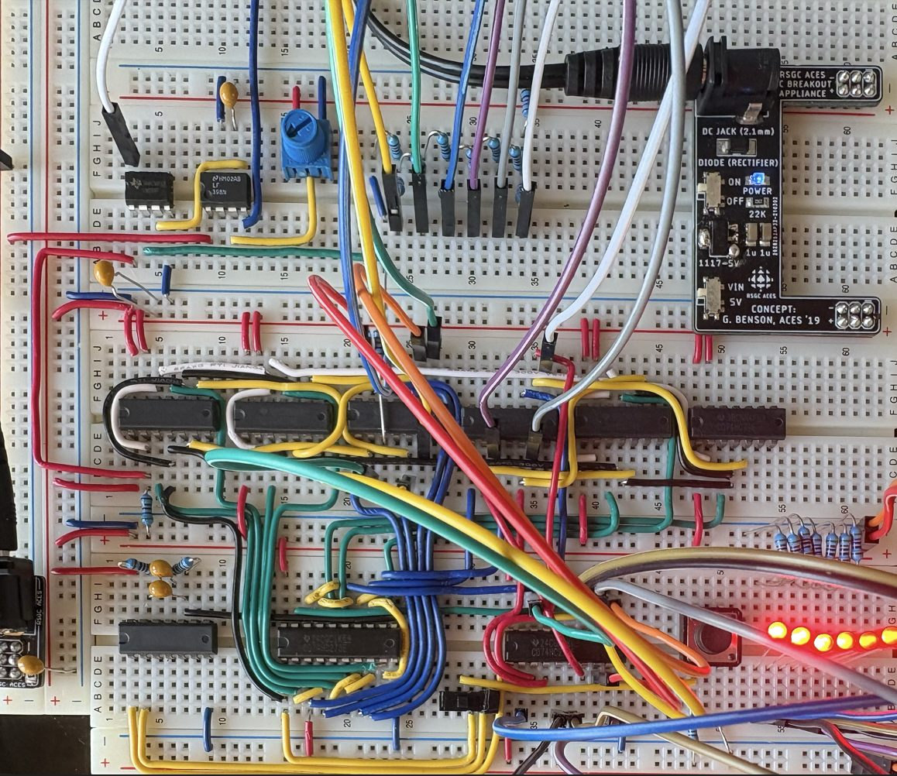
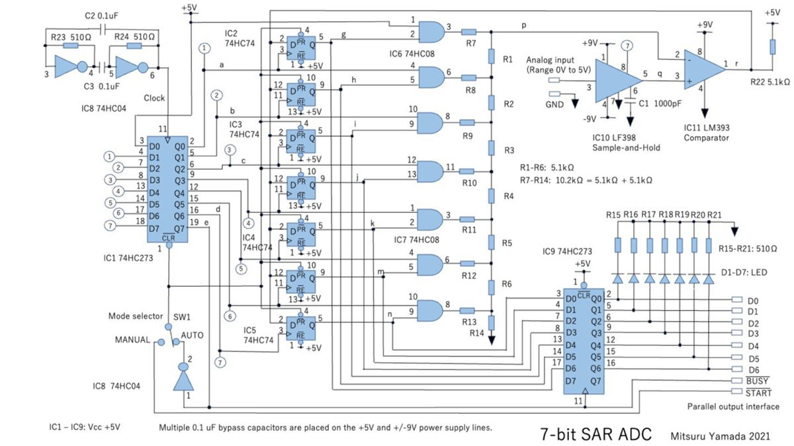
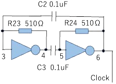
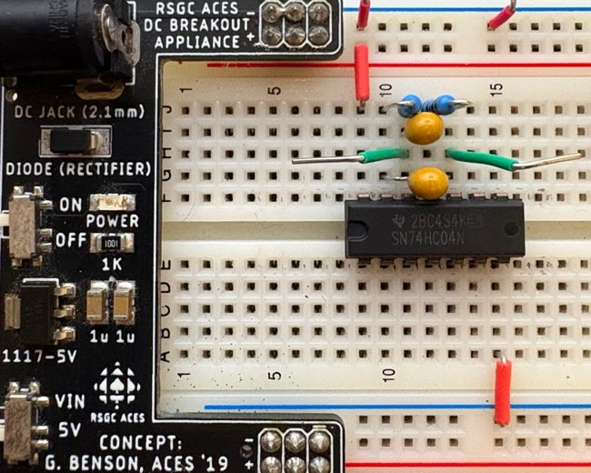
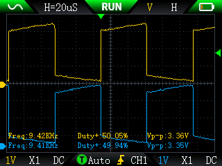
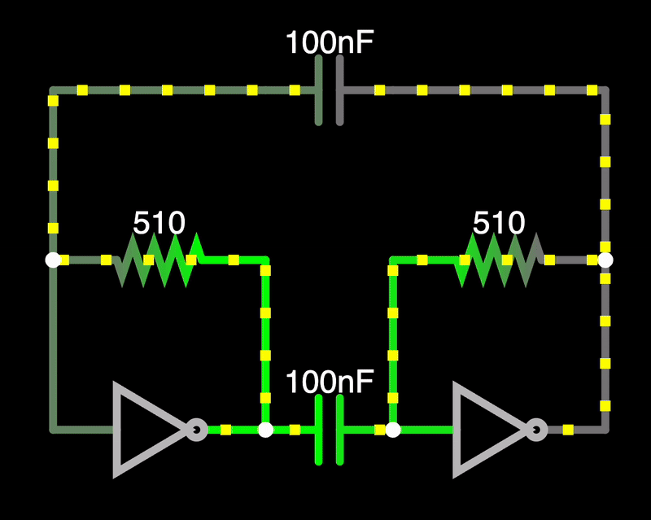
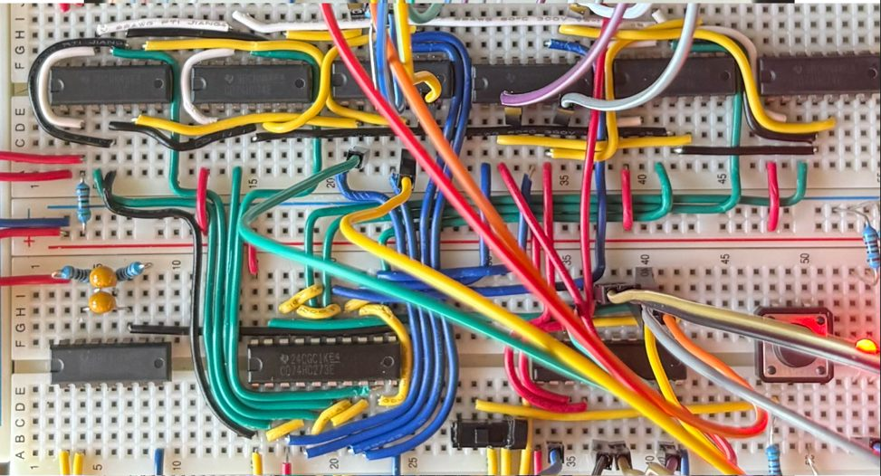

# 7-Bit SAR ADC from Discrete Logic

A **successive-approximation analog-to-digital converter** built on breadboards from individual logic, analog and passive parts rather than a microcontroller's built-in ADC. Turn a potentiometer and a 7-bit binary code follows it.

<p align="center">
  
</p>


## Overview

A SAR ADC converts a voltage with a binary search: starting from the most significant bit, it guesses a bit, checks whether the DAC's trial voltage is above or below the input, keeps or clears the bit and moves to the next. Seven clock steps give a 7-bit result.

| Block | Implementation |
|-------|----------------|
| Clock | Inverter RC relaxation oscillator on an SN74HC04 (about 10 kHz) |
| Sample and hold | LF398 holds the input steady during conversion |
| DAC | 7-bit R-2R ladder (precision 5.1 kohm and 10.2 kohm resistors) |
| Comparator | LM393 compares the held input with the DAC output |
| SAR logic | Four SN74HC74 dual D flip-flops plus two SN74HC08 AND gates |
| Input | Potentiometer, 0-5 V |

<p align="center">
  
</p>

## Build stages

1. **Clock (Project 3.4.1).** Built a dual-inverter RC oscillator from an SN74HC04 on a regulated 5 V supply with a bypass capacitor. An oscilloscope confirmed a clean square wave, the two inverter outputs about 180 degrees out of phase, and a period matching theory.
2. **Analog front end.** Added the LF398 sample-and-hold, the LM393 comparator and the R-2R DAC, and checked the comparator response as the input voltage swept from 0 to 5 V.
3. **SAR logic (Project 3.4.3).** Wired the flip-flops and AND gates to set and clear each bit from the comparator output, then verified the full conversion against the input voltage.

| Clock schematic | Clock on breadboard |
|:---:|:---:|
|  |  |

| Clock on the oscilloscope | Clock simulation |
|:---:|:---:|
|  |  |

| SAR logic stage |
|:---:|
|  |

## Repository layout

```
sar-adc/
├── docs/images/   # Schematic, scope captures, breadboard builds
├── LICENSE
└── README.md
```

## What I learned

- How analog and digital systems meet in real hardware: timing, stability and signal integrity matter far more than the simple algorithm suggests
- Why the clock must be validated on its own before adding logic
- Using an oscilloscope to verify oscillation, phase and frequency
- Debugging a dense breadboard build one stage at a time

## Credits and notes

The SAR ADC design is based on Yamada's discrete 7-bit design (schematic image labelled with Yamada's name) as assigned in the ACES program (Projects 3.4.1 and 3.4.3, Computer Engineering course, 2026). The R-2R ladder idea is covered in [r2r-dac](https://github.com/NateAndrw/r2r-dac). MIT licensed.
